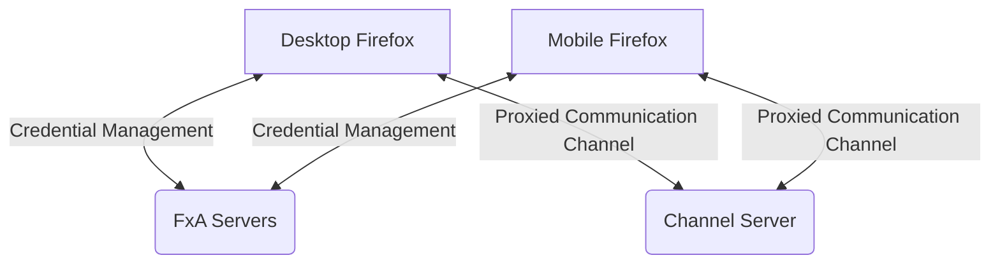
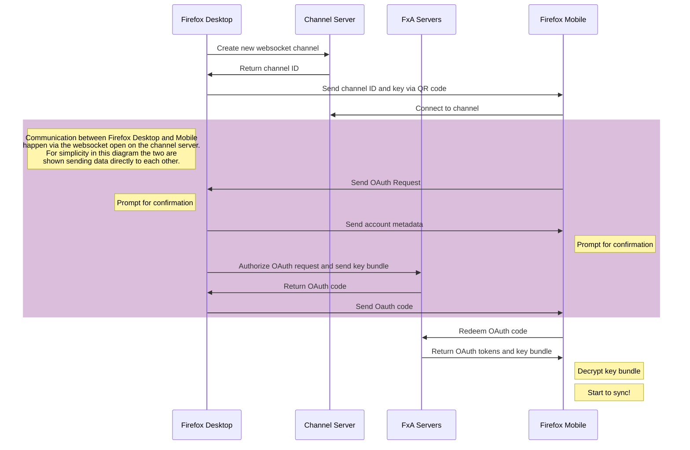
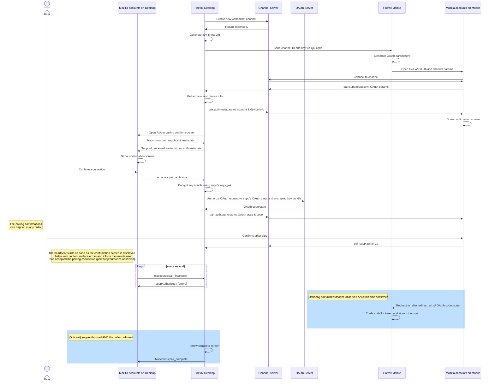
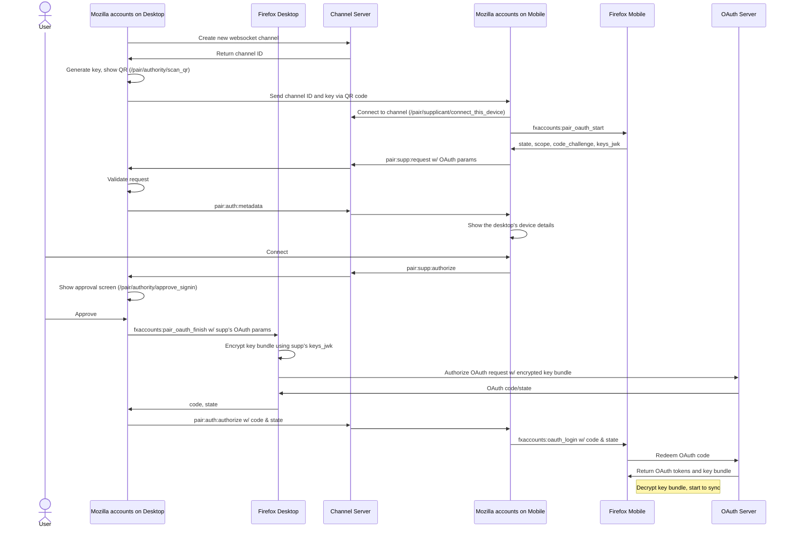

Current as of `October 29th, 2026`

## Pairing Flow Architecture

The goal of the pairing flow is to allow users to quickly connect a mobile browser to Firefox Sync, without having to type their password,
Mozilla accounts allows a mobile device to connect by pairing with an authenticated Firefox profile on their PC via scanning a QR code.
See the [Project Plan Document](https://docs.google.com/document/d/1mFf0sfEK8o1csXLeyK1x4GS9SUMIq4q8bu25LiydPew/edit#) for more information.

The intended user flow operates as follows:

1. On their Desktop (Authority) device, the user selects an option to connect other device, and a QR code is displayed.
1. On their Mobile (Supplicant) device, the user selects an option to connect to Firefox Sync via pairing, which launches a QR code scanner.
1. The user scans the QR code from Desktop with their Mobile device.
1. The devices establish a secure communication channel, and Mobile sends an OAuth request for Desktop to authorize.
1. After confirming on both devices, the user's Mobile is connected to their Firefox Account.

The Desktop (Authority) and Mobile (Supplicant) devices will not communicate directly, because we cannot assume that they will be on
the same network and because this is difficult to achieve from web content.
Instead, they will exchange encrypted messages via WebSocket to a lightweight "channel server" service which can relay messages back and forth.
The flow performs a remote authorization where the already authenticated device generates Sync keys and an OAuth code for the new device.
PKCE facilitates the transfer of the Sync key between devices and the channel server facilitates direct communication between the two, including the final transfer of the OAuth code.

## Pairing versions

Two versions of the web flow are in service. They share the channel server, the `fxa-pairing-channel` encryption and the channel messages below; they differ in who owns the channel on the desktop and in how the phone joins it.

| | v1 | v2 |
| --- | --- | --- |
| Desktop channel owner | Firefox native code, from `about:preferences` | The Mozilla accounts page itself, at `/pair/authority/scan_qr` |
| QR shown by | Firefox (`about:preferences`) | The web page |
| Phone joins at | `/pair/supp?client_id=…#channel_id=…&channel_key=…`, built by the mobile app | `/pair#channel_id=…&channel_key=…&v=2`; the page asks Firefox for the OAuth parameters |
| Approval order | Either side first | Phone first, then desktop |
| Desktop screens | `/pair/auth/*` | `/pair/authority/*` |
| Phone screens | `/pair/supp/*` | `/pair/supplicant/*` |
| Scanned outside Firefox | Unsupported | Hands the URL to the Firefox app, or to the app store |

A browser takes v2 only when all of these hold; otherwise it gets v1:

- The deployment's `pairing.version` is `2`. The default is `1`.
- Firefox reports `capabilities.pairingVersion: 2` in its `fxaccounts:fxa_status` reply. The protocol runs in the browser, so one that only speaks v1 cannot finish a v2 flow.
- When `pairing.v2_min_version.<ios|android|desktop>` names the browser's platform, its major version from the user agent meets that floor. This lets each Firefox platform roll out on its own.

The decision is made in `isPairingV2Enabled` in [`lib/pairing/v2-gate.ts`](https://github.com/mozilla/fxa/blob/main/packages/fxa-settings/src/lib/pairing/v2-gate.ts) and applied on the `/pair` page. The sitemap's [Pairing / CAD](../fxa-sitemap/flow-pairing.md) page lists every screen.

Both versions ask a two-factor account for a TOTP code before any channel is opened, unless Firefox verified one within `pairing.totp_max_age_minutes` (default five minutes). Desktop goes through `/pair/auth/totp` (v1) or `/pair/authority/totp` (v2).



---



### Detailed flow (v1)

In v1 Firefox Desktop's native code creates the channel, shows the QR code in `about:preferences`, and only opens a Mozilla accounts page for the confirmation screen. It is advised to read the following section while looking at the detail diagram.



#### 1) Desktop opens an encrypted channel and advertises it via QR code

To make itself available for pairing, the Desktop device opens a connection to the Channel Server using the [fxa-pairing-channel library](https://github.com/mozilla/fxa-pairing-channel).

Once connected it will receive a server-allocated channel id, then the library will generate a 32-byte channel key to be used for client-side encryption of messages on the channel.

- The channel key is what secures the pairing flow.
  - Any application that learns the channel key will be able to request pairing from the Desktop device, or intercept messages exchanges during the pairing flow.
  - The fxa-pairing-channel library uses a subset the pre-shared key mode of TLS 1.3 for communication between the two devices.
- The channel id and channel key are encoded using base64url and are then combined into a "pairing url".
- The generated URL looks like: `https://accounts.firefox.com/pair#channel_id=[channel_id]&channel_key=[channel_key]`
- This URL is then encoded in a QR code and displayed on screen.

#### 2) Mobile scans the QR code and connects to the encrypted channel

To initiate pairing, the Mobile device scans the QR code displayed by Desktop and extracts the channel id and channel key.
It opens a WebSocket to the Channel Server using the same fxa-pairing-channel library specifying the channel id, channel key.
The Channel Server will now relay WebSocket messages from Mobile to Desktop and vice-versa. The [supplicant integration](https://github.com/mozilla/fxa/blob/main/packages/fxa-settings/src/models/integrations/pairing-supplicant-integration.ts) handles the creation of the `PairingChannelClient` and the state machine. The supplicant triggers messages after user's approval and finally sends
the code to the relier by using the existing OAuth redirection broker.

#### 3) Devices exchange metadata and show confirmation screens

At this point the devices have established a baseline level of trust and can exchange metadata to allow the user to confirm the pairing on both sides.
We use explicit confirmation screens to reduce the risk of phishing or over-the-shoulder attacks.

The Mobile device sends what is essentially an OAuth request, delivered over the WebSocket channel rather than opened as a local web page.
It includes all parameters that would appear in an ordinary OAuth authorization request.
The exceptions are the `scope`and `keys_jwk` parameters, they just get passed through when authorizing the request.

The Desktop device sends an "account metadata" message that includes information about the account being connected to.
The properties of that messages are listed in the "Pairing messages" section.

This information will help the Mobile device show a meaningful confirmation screen.  It's PII, but the channel has established a base level of trust between devices, so it should be safe to share this information directly.

- Upon receiving the metadata message from the other device, both Desktop and Mobile show an explicit confirmation screen.
- To show the confirmation screen on desktop, the Desktop (Authority) side transitions from `about:preferences` Firefox UI to
  the Mozilla accounts page served by the content server. This engages the [authority integration](https://github.com/mozilla/fxa/blob/main/packages/fxa-settings/src/models/integrations/pairing-authority-integration.ts) and establishes [WebChannel communication](https://developer.mozilla.org/docs/Mozilla/JavaScript_code_modules/WebChannel.jsm) with Native code.
- There's no set confirmation order: the Supplicant and the Authority will show the confirmations screens at the same time, and can be accepted in any order.

For additional security, the Channel Server annotates each message with information about the originating device, such as geoip lookup data. This may help the user detect if they're connecting to a different device than expected.

#### 4) Desktop device authorizes OAuth request

When the user accepts the confirmation screen on the Desktop device, it will use its local credentials to authorize the OAuth request from the Mobile device. This involves no user interaction, and will include the following steps:

- Check that redirect_uri is the expected value; error out if not.
- Check that scope contains exactly `"profile"` and `"https://identity.mozilla.com/apps/oldsync"`; error out if not.
- Check that client_id is the expected value; error out if not.
- Check that state exists and is well formed; error out if not.
- Build the scoped-key bundle for `"https://identity.mozilla.com/apps/oldsync"`, encrypting it with the provided `keys_jwk` to produce `keys_jwe`.
- POST all of this to fxa-oauth-server at `/v1/authorization` and receive back an OAuth code and state response parameters.

Desktop will then send the code and state parameters back to Mobile over the WebSocket channel, encrypted as before with the channel key.

#### 5) Mobile receives OAuth response and connects to Sync

When the user accepts the confirmation screen on the Mobile device, it will listen for the message produced by the Desktop device in step (4) above.
After receiving the message, it can tear down its WebSocket channel. The supplicant broker redirect step is captured by the Native app, as part of that step the `code` and `state` params are extracted from the redirect url.

- The mobile application can now complete its OAuth flow in its Native code just as if it had received code and state via a standard web-content-based OAuth flow:
- Submit the code to fxa-oauth-server at `/v1/token` in exchange for an access token, refresh token, and bundle of encrypted key material.
- Decrypt the bundle of key material with its keys_jwk private key.
- Fetch user profile data, and check that it matches the data provided by Desktop in step (3).
- Use the access token and key material to access Firefox Sync.

### Detailed flow (v2)

In v2 the Mozilla accounts page on the desktop creates the channel and shows the QR code; Firefox's native code is only asked to start and finish the OAuth request. The code lives in the same two integrations as v1 and in the pages under [`pages/Pair2`](https://github.com/mozilla/fxa/tree/main/packages/fxa-settings/src/pages/Pair2).



#### 1) The desktop page opens a channel and shows the QR code

`/pair` sends a signed-in Firefox desktop that qualifies for v2 to `/pair/authority/scan_qr`. That page waits for `fxaccounts:fxa_status`, runs the TOTP check, and only then creates the channel with the `fxa-pairing-channel` library against `pairing.server_base_uri`. A signed-out desktop, or one that signs out while the QR is on screen, gets no channel.

The QR code encodes `https://accounts.firefox.com/pair?utm_content=DTM_SYNC_PAIR_V2#channel_id=[channel_id]&channel_key=[channel_key]&v=2`. The channel id and key are in the fragment, so they never reach the server; `utm_content` is in the query so a scan can be told apart from other visits to `/pair`. The page then moves to `/pair/authority/continue_on_mobile` and waits.

#### 2) The phone opens the URL and joins the channel

The phone opens the URL in whatever handled the scan. On load the page lifts the fragment out of the URL into `sessionStorage` (see [`lib/pairing-channel-params.ts`](https://github.com/mozilla/fxa/blob/main/packages/fxa-settings/src/lib/pairing-channel-params.ts)), so the channel key cannot leak into telemetry that records `location.href`. `/pair` then routes by browser:

- **Firefox for Android or iOS that qualifies for v2**: `/pair/supplicant/connect_this_device`, which opens the channel with the scanned id and key. A phone that is already signed in to a verified account is sent to `/pair/supplicant/timeout_and_cancel` instead, because it has nothing to pair.
- **Firefox mobile that does not qualify** (too old, or its platform not rolled out): `/pair/supplicant/connect_hint`, which tells the user to scan again from inside the Firefox app.
- **Any other browser**: `/pair/supplicant/download_firefox`, which hands the pairing URL to the Firefox app. Android fires an `intent://…;package=org.mozilla.firefox;S.browser_fallback_url=<Play Store>;end` deep link on load; iOS opens `firefox://open-url?url=<pair URL>` once `pairing.v2_min_version.ios` is set, and the connect hint page before that. Either way the app store is the fallback when Firefox is not installed. See [`lib/pairing/handoff.ts`](https://github.com/mozilla/fxa/blob/main/packages/fxa-settings/src/lib/pairing/handoff.ts).

Once connected, the supplicant page asks its own Firefox for the OAuth parameters with `fxaccounts:pair_oauth_start` and sends them to the desktop as `pair:supp:request`. When the Firefox app itself scanned the QR, application-services has already started OAuth and put the parameters in the URL, and those are used instead.

#### 3) The desktop validates the request and both sides confirm

The authority validates every field of `pair:supp:request` before it can reach an approval screen, then replies with `pair:auth:metadata`. Each side shows the other device's details, which come from the channel server's sender envelope (user agent, city, region, country, IP address) rather than from the message body.

Unlike v1, the order is fixed: the phone confirms first (`pair:supp:authorize`, after which it waits on `/pair/supplicant/approve_signin`), and only then does the desktop move from `continue_on_mobile` to `/pair/authority/approve_signin`.

#### 4) The desktop authorizes through Firefox

When the user approves on the desktop, the page sends the supplicant's OAuth parameters to Firefox with `fxaccounts:pair_oauth_finish`. Firefox's native code builds the scoped-key bundle, encrypts it with the supplicant's `keys_jwk`, authorizes the request against the OAuth server and returns the `code` and `state`. The page checks the echoed `state`, sends `pair:auth:authorize` with the code and state, and shows `/pair/authority/sync_success`.

#### 5) The phone finishes OAuth in its Firefox

The supplicant checks the `state` against the one it requested, then hands the code to its Firefox with `fxaccounts:oauth_login` (`redirect: urn:ietf:wg:oauth:2.0:oob:oauth-redirect-webchannel`, `action: pairing`). Firefox redeems the code at `/v1/token`, decrypts the key bundle and starts Sync. The page marks the channel as consumed in `sessionStorage` so a reload after the login lands on `/pair/supplicant/sync_success` rather than trying to reopen a channel the server has already closed.

Either side can cancel with `pair:auth:cancel` or `pair:supp:cancel`; the other lands on its `timeout_and_cancel` screen with the reason, instead of waiting for the channel to time out.

## Intended Security Properties

The security-related design goals of this system are as follows:

- The result of the flow is the same as if the Mobile device had done an ordinary
  web-content-based OAuth flow. It obtains its own OAuth tokens for the user's Firefox
  account, with appropriate scopes and a copy of the relevant key material.
- The messages relayed between Desktop and Mobile cannot be read or forged by any
  other party.
- On the signed-in Desktop device:
  - The flow cannot be used to surreptitiously extract FxA key material (such as the
    user's sync keys) from the browser, not even by Mozilla's servers or by web
    content running on https://accounts.firefox.com.
  - There is no way for third-party web content to initiate a pairing flow, which might
    be used for phishing purposes.
- On the connecting Mobile device:
  - Handling of FxA key material is as or more secure than the existing web-based
    scoped-keys flow.
  - There is no way for third-party apps or web content to trigger the pairing flow,
    which might be used for phishing purposes.
  - If the user scans the QRcode with a third-party app rather than a Mobile Firefox
    browser, then that app can only gain access to the user's account by actively
    phishing the user into completing the flow; it cannot silently insert itself as
    a meddler-in-the-middle of a legitimate flow with the user's actual Firefox browser.

These properties are enforced by the following features/mitigations:

- The communication channel between the two devices is secured by:
  - Communication between Desktop and Mobile is encrypted and authenticated using a
    TLS1.3 PSK handshake, with the key obtained by scanning the QR code. This guards
    against eavesdropping or MitM by anyone who does not have the channel key
    (including the channelserver that is proxying the messages, since it has no way to
    obtain the key).
  - Communications are routed through the Mozilla-hosted channelserver, authenticated
    with standard TLS PKI. The channelserver enforces that only two connections are
    made on a channel, providing additional protection against eavesdropping or MitM
    by third-party software _even if_ such software somehow obtains the channel key.
  - The mobile device must directly scan the QR code in order to initiate the flow.
    This prevents a third-party scanner that happens to intercept the channel key
    from inserting itself as a MitM, with one channel open to the Desktop device and
    a second channel open to the Mobile device.
- Inside the communication channel, the devices execute a largely unmodified variant of
  the existing FxA scoped-keys OAuth flow, so the exchange inherits the existing
  security boundaries/properties of that flow.
- When authorizing the OAuth request, Firefox Desktop is directly responsible for
  encrypting the scoped-keys bundle using the OAuth request parameters it received over
  the pairing channel. There is thus no opportunity for web content running on the
  desktop device to see the raw scoped-keys key material.
  - Web content cannot, for example, inject its own `keys_jwk` parameter into
    the OAuth flow in order to MitM the scoped-keys exchange. This is an improvement
    over the current state of the web-based OAuth flow, in which web content can
    directly handle the account key material.
- In v2 the desktop web page owns the channel and relays the OAuth parameters, but the
  scoped-keys bundle is still built and encrypted by Firefox's native code in response to
  `fxaccounts:pair_oauth_finish`, so web content never sees key material in either version.

## Exchanged messages specification

The pairing flow is made possible by messages that are forwarded between the Desktop native code and the web content page opened on the supplicant device.

The Firefox Desktop native code gathers information from web content via WebChannels and communicates that to the supplicant using the
channel server socket.

Meanwhile, the web content opened on the supplicant device connects directly to a WebSocket, without native code infrastructure.
It waits for user's approval on both sides of the flow and once that is achieved, it can receive the OAuth `code` and `state`
from the authority side of the pairing flow.

### Pairing Channel messages

The message payload is a JSON object that contains a message identifier and a data object.
Every message envelope also contains information about the sender (IP address, geolocation..).
Here's an example of the channel server envelope:

```json
data: {
  ...,
  "remoteMetaData": {
    "city": "Kanata",
    "country": "Canada",
    "region": "Ontario",
    "ua": "Mozilla/5.0 (Macintosh; Intel Mac OS X 10.10; rv:40.0) Gecko/20100101 Firefox/40.0",
    "ipAddress": "1.1.1.1"
  }
}
```

#### pair:supp:request

Direction: Supp -> Auth

Description: Sent right after connecting to the pairing channel by the supp. Contains OAuth request parameters, a key encryption JWK if required by the relier. In v2 the authority rejects a request without `keys_jwk`, and the parameters come from `fxaccounts:pair_oauth_start` rather than the URL.

```json
{
  message: "pair:supp:request",
  data: {
    // See the OAuth server API doc for a description of the parameters.
    access_type,
    client_id,
    code_challenge,
    code_challenge_method,
    // FxA Scoped Keys key-fetching public key (base64url encoded).
    [keys_jwk,].
    scope,
    state,
  },
}
```

#### pair:auth:metadata

Direction: Auth -> Supp

Description: Sent by the Auth and contains the account and device information of the Auth. In v2 the payload is empty: the supplicant shows the device details carried in the channel server's sender envelope.

```json
{
  message: "pair:auth:metadata",
  data: {
    email,
    avatar,
    displayName,
    deviceName,
  },
}
```

#### pair:auth:authorize

Direction: Auth -> Supp

Description: Sent by the Auth once the pairing has been confirmed by the user on this side. Contains an OAuth code that can be traded for a token. v2 sends only `code` and `state`.

```json
{
  message: "pair:auth:authorize",
  data: {
    // See the OAuth server API doc for a description of the parameters.
    code,
    state,
    redirect,
  },
}
```

#### pair:supp:authorize

Direction: Supp -> Auth

Description: Sent by the Supp once the pairing has been confirmed by the user on this side.

```json
{
  message: "pair:supp:authorize",
}
```

#### pair:auth:cancel and pair:supp:cancel

Direction: Auth -> Supp, and Supp -> Auth

Description: Sent with an empty payload when the user cancels on that side, before the channel is closed, so the other device can show "canceled" rather than a timeout.

### WebChannel messages

The Mozilla accounts page communicates with the Firefox that embeds it using WebChannel.
WebChannel messages can only be initiated from the content side, however the native side can send a response.
In v1 these run between the desktop page and Firefox Desktop, which owns the channel. In v2 the desktop page owns the channel and uses only `pair_oauth_finish`; the phone page uses `pair_oauth_start` and `oauth_login` with Firefox Mobile.

#### fxaccounts:pair_preferences

v1 only. Sent by `/pair` on a Firefox desktop that does not qualify for v2. Firefox opens `about:preferences`, creates the channel and shows the QR code.

#### fxaccounts:pair_oauth_start

v2 only, sent by the supplicant page to Firefox Mobile. Asks Firefox to begin an OAuth request for the default Sync scopes. The reply carries `state`, `scope`, `code_challenge`, `code_challenge_method` and `keys_jwk`, which the page forwards in `pair:supp:request`.

#### fxaccounts:pair_oauth_finish

v2 only, sent by the authority page to Firefox Desktop with the supplicant's `client_id`, `state`, `scope`, `code_challenge`, `code_challenge_method` and `keys_jwk`. Firefox encrypts the scoped keys into `keys_jwe`, authorizes the request and replies with `code` and `state`. The page rejects a reply whose `state` differs from the one it sent.

#### fxaccounts:oauth_login

Sent by the supplicant page to its Firefox with the `code` and `state` received in `pair:auth:authorize`, plus `redirect: urn:ietf:wg:oauth:2.0:oob:oauth-redirect-webchannel` and `action: pairing`. Firefox completes the OAuth flow natively.

#### fxaccounts:pair_supplicant_metadata

v1 only. Allows the web content to request the supp’s device information.

Expected response:

```json
{
  ua,
  city,
  region,
  country,
  ipAddress,
}
```

#### fxaccounts:pair_authorize

v1 only. Allows the web content to inform the native side the confirmation dialog has been accepted. `fxaccounts:pair_decline` is its counterpart when the user refuses.

Expected response: N/A

#### fxaccounts:pair_heartbeat

v1 only. Sent by the web content every second or so. Allows to surface errors but to also transition to a "completed" screen once the supp side has confirmed the pairing request.

Expected Response:

```json
{
  err, // String
}
<OR>
{
  suppAuthorized, // Boolean
}

```

#### fxaccounts:pair_complete

v1 only. Allows the web content to inform the native side it is aware the flow is finished, has shown a confirmation screen and the resources can be finalized on the native side.

Expected Response: N/A

## Other Details

### Routes

Every pairing screen is listed on the sitemap's [Pairing / CAD](../fxa-sitemap/flow-pairing.md) page. The entry points are:

- `https://accounts.firefox.com/pair` on both devices. It decides the version and the role from the browser, the `fxa_status` reply and the URL fragment, then forwards to one of the pages below.
- v2 desktop (Authority): `/pair/authority/scan_qr`, then `continue_on_mobile`, `approve_signin`, `sync_success`; `totp`, `timeout_and_cancel` and `download_firefox` for the detours.
- v2 phone (Supplicant): `/pair/supplicant/connect_this_device`, then `approve_signin`, `sync_success`; `download_firefox`, `connect_hint` and `timeout_and_cancel` for the detours.

The v1 routes:

- The Mobile (Supplicant) side, implements the following URL: `https://accounts.firefox.com/pair/supp`

This view accepts OAuth query parameters equivalent to those on the existing /oauth/ view, and will accept the channel id and channel key as parameters in the URL hash fragment.  The view performs the entire Mobile side of the protocol, including:

- connecting to the provided channel via WebSocket
- passing the OAuth request to the Desktop over the WebSocket channel
- displaying a confirmation screen using the account metadata information sent by Desktop
- receiving OAuth code and state from Desktop over the WebSocket channel.
- completing the OAuth flow by redirecting back to the relier

* The Desktop (Authority) side, loads the following URL: `https://accounts.firefox.com/pair/auth`

This view establishes communication with Native Desktop code. The Native Desktop code takes care of the following:

- establishing the WebSocket channel and corresponding secret key
- displaying the QR code as a URL to `https://accounts.firefox.com/pair`
- receiving the OAuth request from the Mobile device
- constructing the keys_jwe bundle and authorizing the OAuth request
- return the OAuth code to the Mobile device over the WebSocket channel
- communicating between Native code and Authority web content using WebChannels

### QR Code and URLs

The v2 QR code is a URL: `https://accounts.firefox.com/pair?utm_content=DTM_SYNC_PAIR_V2#channel_id=XYZ&channel_key=ABC&v=2`

The phone opens it as scanned. The page reads the channel from the fragment and obtains the OAuth parameters from Firefox over WebChannel, so no longer URL is built. The same URL is what a non-Firefox browser hands to the Firefox app.

The v1 QR code is a URL: `https://accounts.firefox.com/pair/#channel_id=XYZ&channel_key=ABC`

When the Mobile device scans this from the QR code, it parses out the channel parameters and combines them with its OAuth request parameters to produce a URL like the following:

```
https://accounts.firefox.com/pair/supp
?client_id=<the client's oauth client id>
&state=<generated state token>
&scope=<scopes to request>
&code_challenge=<generated PKCE challenge>
&code_challenge_method=<generated PKCE challenge method>
&keys_jwk=<generated public key>
&redirect_uri=<the client's registered redirect_uri>
#channel_id=XYZ&channel_key=ABC
```

Open the constructed URL, just as it would if it were initiating a standard username-and-password OAuth flow.
Wait for a redirect from the opened OAuth flow to return `code` and `state` parameters.

- After the OAuth flow redirects with the `code`, it can be exchanged for the `keys_jwe` bundle.
- Decrypt the key bundle using corresponding private key for `keys_jwk`.
- The Desktop pairing flow implements a custom `redirect_uri` - `urn:ietf:wg:oauth:2.0:oob:pair-auth-webchannel`. This indicates that this is a pairing flow.
